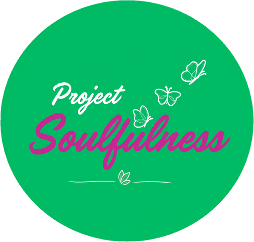

<div align="center">



# Project Soulfulness

**Good People. Better Days.**

The official website of Project Soulfulness — a garden café and social-wellness community in Madhapur, Hyderabad.

**Live:** [www.projectsoulfulness.com](https://www.projectsoulfulness.com)


</div>

---

## Table of contents

- [About](#about)
- [Features](#features)
- [Tech stack](#tech-stack)
- [Getting started](#getting-started)
- [Project structure](#project-structure)
- [Managing content](#managing-content)
- [SEO](#seo)
- [Brochure pages](#brochure-pages)
- [Deployment](#deployment)
- [Roadmap](#roadmap)
- [License](#license)

## About

Project Soulfulness is a non-clinical social-wellness space — part coffee shop, part community sanctuary — where young people can unwind, connect and find balance. This repository contains its marketing website: a fast, mostly static Next.js site that introduces the space, its experiences and events, promotes the launch, and publishes a blog.

**Launch dates:** Pre-launch on **21 November 2026** (with a pre-launch weekend of events on 21–22 Nov at White Teak Coffee Roasters, Mysuru) and Grand Launch on **5 December 2026**.

**Experiences featured:** café & coffee raving · French bulldog companionship · travel cluster · jamming sessions · stand-up comedy · curated healthy menu · inspirational talks · weekend workshops.

## Features

- **Animated hero** — a swipeable photo stack and an orbit of experience photos circling the logo.
- **Save the Dates** — a home page section with the Pre-launch and Grand Launch dates, live day countdowns, a WhatsApp reminder button and an embedded map of the pre-launch venue. It hides itself once the Grand Launch has passed.
- **Home page sections** — About, Experiences, Who We Serve, Positioning, Events and the latest blog posts.
- **Blog ("The Soulful Journal")** — statically generated articles, each with its own SEO metadata.
- **Events calendar** — event cards with date, time, venue and a "Reserve a spot" button that opens WhatsApp. A single switch toggles between this calendar and a "Coming soon" preview.
- **WhatsApp enquiries** — the contact form, Join, Remind me, Notify me and Reserve buttons all open a pre-filled WhatsApp chat (no backend required).
- **Contact page** — contact details, a Google Maps link and the message form.
- **Brand touches** — an intro splash animation, flying butterflies, drifting leaves and a butterfly cursor.
- **Responsive and accessible** — mobile-first layouts, keyboard-friendly controls, image alt text, and reduced-motion support for all animations.
- **Content-driven** — nearly all copy, images and data live in two TypeScript files.

## Tech stack

| Area | Technology |
|---|---|
| Framework | [Next.js 16](https://nextjs.org/) (App Router, static generation) |
| UI | [React 19](https://react.dev/) |
| Language | [TypeScript 5](https://www.typescriptlang.org/) |
| Styling | [Tailwind CSS 4](https://tailwindcss.com/) + custom CSS animations |
| Icons | [lucide-react](https://lucide.dev/) |
| Fonts | Outfit, Lora, Caveat, Dancing Script (via `next/font/google`) |
| Linting | ESLint (`eslint-config-next`) |

## Getting started

### Prerequisites

- [Node.js](https://nodejs.org/) **20.9 or later**
- npm (bundled with Node.js)

### Installation

```bash
git clone https://github.com/Project-Soulfulness/Website.git
cd Website
npm install
npm run dev
```

Open [http://localhost:3000](http://localhost:3000) in your browser.

### Available scripts

| Command | Description |
|---|---|
| `npm run dev` | Start the development server with hot reload |
| `npm run build` | Create an optimised production build |
| `npm run start` | Serve the production build locally |
| `npm run lint` | Run ESLint across the project |

## Project structure

```
Website/
├── brochure/                   Standalone printable brochure and teaser pages
├── public/
│   └── images/                 Photos and logo
├── src/
│   ├── app/                    Routes (Next.js App Router)
│   │   ├── page.tsx            Home page
│   │   ├── blog/               Blog listing and [slug] article pages
│   │   ├── events/             Events page
│   │   ├── contact/            Contact page
│   │   ├── layout.tsx          Root layout, fonts and site-wide metadata
│   │   ├── globals.css         Brand tokens and animations
│   │   ├── favicon.ico, icon.png, apple-icon.png   Site icons
│   │   ├── sitemap.ts          Generated sitemap.xml
│   │   └── robots.ts           Generated robots.txt
│   ├── components/             UI components (one per page section)
│   └── lib/
│       ├── content.ts          Site copy and data
│       ├── blogs.ts            Blog posts
│       └── useReveal.ts        Scroll-reveal animation hook
├── next.config.ts
└── package.json
```

### Routes

| Route | Description |
|---|---|
| `/` | Home |
| `/blog` | Blog listing |
| `/blog/[slug]` | Blog article (statically generated) |
| `/events` | Events calendar (or a "Coming soon" preview when switched off) |
| `/contact` | Contact details and message form |

## Managing content

Content is separated from layout, so most updates don't require touching any component.

### Site content — `src/lib/content.ts`

| Export | Controls |
|---|---|
| `navLinks` | Navbar and footer links |
| `heroGallery` | Hero photo stack images and captions |
| `heroPillars` | The four highlights in the About section |
| `problemSolutionPromise` | Problem / Solution / Promise cards |
| `experiences` | Experience cards (`image`) and hero orbit photos (`orbitImage`) |
| `audiencePoints` | "Who We Serve" list |
| `launchDates` | Pre-launch and Grand Launch dates, notes and the pre-launch venue (name, map link, embed) |
| `eventsLive` / `events` | Events switch and the event calendar |
| `testimonials` | Member reviews (sample text; section currently hidden) |
| `contact` / `siteUrl` | Email, phone (+91 80507 66965), WhatsApp number, address, map link and production domain |
| `whatsappLink()` | Builds the pre-filled WhatsApp links used across the site |

### Blog posts — `src/lib/blogs.ts`

Add an entry to `blogPosts` and the blog listing, the article page, the home page's "Recent Blogs" section and the sitemap all update automatically. Each post supports a title, excerpt (used as the meta description), category, date, read time, cover image, keywords and a body made of paragraphs, headings, lists and quotes.

> Keep cover images under ~1600px wide and a few hundred KB — images are served as-is.

### Events

The calendar is switched on. To go back to the "Coming soon" preview:

```ts
// src/lib/content.ts
export const eventsLive = true; // false → "Coming soon" preview with no dates or booking
```

Each entry in `events` has a date, title, tagline, category, image and details. Two fields are optional:

- `start` / `end` — 24-hour times such as `"18:30"`. Without them the card shows `timeNote` (e.g. `"Morning"`) or "Timing to be announced".
- `venue` — a name and Google Maps link. Without it the café address is shown.

Keep events in date order: the home page shows the first four and `/events` shows them all.

### Launch dates

Edit `launchDates` in `src/lib/content.ts` to change the dates, notes or the pre-launch venue shown in the Save the Dates section.

## SEO

- Per-page titles, descriptions, canonical URLs and Open Graph / Twitter preview images
- Structured data (JSON-LD): website name, organisation and logo, local business (café), blog articles and events
- Site icons (`favicon.ico`, `icon.png`, `apple-icon.png`) that Google uses next to search results
- Auto-generated `sitemap.xml` and `robots.txt`
- Location-focused keywords for local search in Hyderabad

`siteUrl` in `src/lib/content.ts` must stay `https://www.projectsoulfulness.com` (the bare domain redirects to `www`), so canonical URLs and the sitemap match the live site.

## Brochure pages

The `brochure/` folder holds standalone HTML pages (brochures and "coming soon" teasers) for printing or sharing. They are not part of the Next.js site — open them directly in a browser. Update the phone number in these files by hand if it changes.

## Deployment

The site is hosted on [Vercel](https://vercel.com/) and deploys automatically:

1. Create a branch, commit your changes and open a pull request against `main`.
2. Vercel builds a preview for the pull request.
3. Merging into `main` deploys to [www.projectsoulfulness.com](https://www.projectsoulfulness.com) within a few minutes.

Run `npm run build` locally before opening a pull request to catch errors early. Submit the sitemap (`https://www.projectsoulfulness.com/sitemap.xml`) in [Google Search Console](https://search.google.com/search-console) so Google picks up changes quickly.

## Roadmap

- [x] Switch on the events calendar
- [x] Upgrade to the latest Next.js 16.x release
- [ ] Add exact timings for the pre-launch events
- [ ] Replace stock photos with real photos from the space and events
- [ ] Publish real member testimonials (the section is ready but hidden)
- [ ] Add security headers in `next.config.ts`

## License

© Project Soulfulness. All rights reserved. This repository is not licensed for reuse or redistribution.
